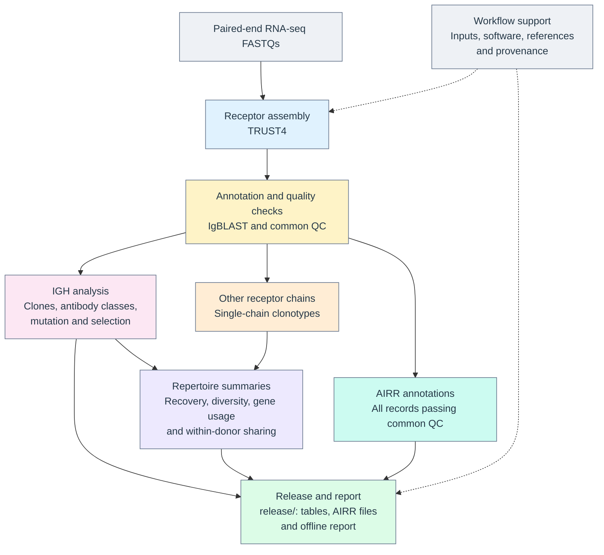

# airrborne

[](https://github.com/swarbricklab/airrborne/actions/workflows/unit-tests.yaml) [](LICENSE) [](envs/snakemake_9.27.1.yaml) [](https://workflowhub.eu/workflows/2373) [](https://doi.org/10.5281/zenodo.23976782)

airrborne recovers human B-cell and T-cell receptor sequences from paired-end bulk RNA-seq. It produces tables, files in the Adaptive Immune Receptor Repertoire (AIRR) format and an interactive report that opens in a web browser. The report covers receptor recovery, diversity, antibody isotypes, mutation and receptor sharing between libraries from the same donor.

The pipeline covers seven receptor loci: IGH, IGK, IGL, TRA, TRB, TRD and TRG. Results are saved in a `release/` folder for each set of libraries analysed together.

[Run the synthetic example](#quick-start).

## Check your data

airrborne supports human paired-end bulk RNA-seq supplied as gzipped FASTQ files. It analyses reads as supplied, without trimming or filtering them. The configuration has no settings for read length, strandedness or adapters.

For a first run on your own data, start with [a few libraries](docs/running.md#samplesheet) to see how many receptors are recovered. A library is one sequenced preparation. The running guide explains which results to check before adding the rest of the dataset. Use the memory and runtime records from this first run to plan resources for the full analysis, following the [resource notes](docs/running.md#resources-on-a-cluster).

## Choose a system

| System | Start here |
|---|---|
| Linux workstation or macOS | Follow the quick start and check the [platform evidence](docs/running.md#platform-and-runtime-evidence); macOS is unverified. |
| Another cluster | Follow [run on a cluster](docs/running.md#run-on-a-cluster) to run inside an allocation, with a Slurm batch script as the example, or to configure a site profile. |
| NCI Gadi with PBS Pro | Follow the [Gadi section](docs/running.md#gadi) for the bundled profile and preparation in a `copyq` job. Its deployment check replaces the quick start. |

## Quick start

Run the bundled synthetic example to check the installation and see a report. It contains four libraries from two donors and starts from receptor assemblies already included in the repository. Install:

- [Git](https://git-scm.com/downloads) and [Conda through Miniforge](https://github.com/conda-forge/miniforge#install).
- [Apptainer](https://apptainer.org/docs/admin/latest/installation.html), Singularity or [Docker](https://docs.docker.com/engine/install/) on Linux; [Docker Desktop](https://docs.docker.com/desktop/setup/install/mac-install/) on macOS.

The workflow uses Snakemake 9 to organise the analysis steps. The setup command below installs the pinned version along with the other software. Setup needs network access, and Docker needs to be running if it is the chosen container runtime. The [glossary](docs/glossary.md#software-and-execution) explains Snakemake, container images and profiles.

```bash
git clone --recursive https://github.com/swarbricklab/airrborne.git
cd airrborne
./setup.sh --config test/system/config.yaml --tests --no-browsers
source .snakemake/env.sh
./test/system/run.sh post-trust4 --work-dir .snakemake/quickstart \
  -- --cores 2
```

A successful run prints `System test passed: post-trust4 (public)`. Open the example report in a web browser:

```text
.snakemake/quickstart/results/airrborne/scopes/project_a/release/report/index.html
```

The example produces two project reports; the path above opens `project_a`. To repeat the test, omit `--work-dir` to create a fresh directory automatically. A specified work directory must be absent or empty.

This example checks the steps from annotation to the finished release. To test assembly from reads as well, follow the [FASTQ test instructions](test/README.md#check-a-complete-change). The [environment guide](docs/running.md#prepare-the-environment) lists storage needs and recorded setup times. R runs inside the analysis image, so no separate R installation is needed.

## Run your own data

Run from the clone's root. The [running guide](docs/running.md) gives environment and input requirements for local and cluster execution.

1. Edit [config/airrborne/config.yaml](config/airrborne/config.yaml) to set the input and output paths. Its comments define each setting and valid value. The default paths are:

   ```yaml
   deps:
     samplesheet: config/airrborne/samplesheet.csv
     data: data/
     resources: resources/airrborne/
   outs:
     results_dir: results/airrborne/
     log_dir: logs/airrborne/
   ```

2. Replace the rows of [config/airrborne/samplesheet.csv](config/airrborne/samplesheet.csv) with one row per sequencing library. Each `path` is a directory below `deps.data`:

   ```csv
   library_id,tissue_id,donor_id,path,sequencing_batch
   library_a,tissue_1,donor_1,batch_1/library_a,batch_1
   ```

   The first four columns are required. Each library belongs to one tissue specimen, and each specimen belongs to one donor. Use a unique `donor_id` for each person across the whole samplesheet. If two studies reuse donor codes, add a study prefix. Every row is analysed, so select any technical replicates before running.

3. Point `deps.data` at the parent directory of the library folders. The pipeline reads the FASTQs in place. With the row above and the default `data/`, it looks for `library_a` in `data/batch_1/library_a/`.

   Supported filenames include `<prefix>_R1.fastq.gz` paired with `<prefix>_R2.fastq.gz`, and SRA's `<prefix>_1.fastq.gz` paired with `<prefix>_2.fastq.gz`. The [input guide](docs/running.md#prepare-inputs) covers other patterns, multiple lanes and how to organise files using symbolic links.

4. Install the software, preview the planned jobs with `-n`, then run the analysis:

   ```bash
   ./setup.sh
   ./run_module.sh -n
   ./run_module.sh
   ```

   Put the inputs in place before setup, because it reads the configuration and checks the workflow. Setup installs Snakemake, downloads the container images and prepares the software for exports and reports. After setup, the analysis needs no network access. On a cluster, follow [run on a cluster](docs/running.md#run-on-a-cluster) to choose where to run each step.

The local run uses at most 8 cores. Add `-- --cores N` to change that limit. The pipeline prepares its human IMGT reference from the pinned analysis image. Each release records the reference identity, download date and audit outcome.

Optional tasks are in the [running guide](docs/running.md):

- [Analyse projects separately](docs/running.md#project-membership). Compare groups such as responders and non-responders within one release instead, as [scopes](docs/running.md#scopes) explains.
- [Add annotations to the report](docs/running.md#add-report-metadata).
- [Reuse retained assemblies](docs/running.md#reuse-retained-assemblies).
- [Deploy in an analysis repository](docs/running.md#deploy-in-an-analysis-repository).

## Read the results

Open `results/airrborne/scopes/cohort/release/report/index.html` in a web browser. The report works offline and needs no server. For results on a remote machine, follow [open the report](docs/running.md#open-the-report).

A scope is one analysed set of libraries. The `cohort` scope contains every library in the samplesheet. Each optional project has a separate release under `scopes/<project>/release/`, with the same files:

| File inside `release/` | Use |
|---|---|
| `report/index.html` | Explore the results offline. |
| `metrics/headline.tsv` | Start a table-based analysis, with one row per library. |
| `data_dictionary.csv` | Look up column definitions, units and missing values. |
| `README.md` | Find detailed files, joins and the methods as run. |
| `airr/` | Read common-QC annotations and linked repertoire metadata. |
| `provenance.json`, `effective_config.yaml` | Identify the source, tools, reference and settings. |
| `manifest/release_files.tsv` | Check each released file's size and SHA-256 hash. |

Start with `metrics/headline.tsv` for input depth, receptor yields, IGH/TRB diversity, antibody classes and somatic hypermutation (SHM). Read estimates alongside their support counts and availability status. Empty estimates are unavailable or inapplicable; zero is a measured value.

These results describe the receptor sequences recovered from bulk RNA-seq. `consensus_count` measures the read support for a sequence. Cell counts, molecule counts and receptor-chain pairings are unavailable from this analysis. Low recovery can also leave a receptor undetected. The [interpretation guide](docs/interpretation.md#find-the-table-for-a-question) explains these limits and points to the detailed tables for each question.

Copy the whole `release/` folder when sharing results, because the report reads neighbouring files. Save edited tables separately: released tables can be hard links to the working results. The [portable-copy check](docs/running.md#copy-and-verify-a-portable-release) verifies the copied files. To rerun analysis from assemblies, also retain the [native inputs](docs/running.md#reuse-retained-assemblies) outside the release.

## Analysis overview

Receptor sequences are assembled from the reads with TRUST4, then annotated with IgBLAST and checked for quality. The analysis then follows separate paths for immunoglobulin heavy chains (IGH) and the other receptor chains.

IGH clones are inferred from related sequences across each donor's libraries within a scope. For the other chains, clonotypes group sequences within each library by an exact nucleotide junction and a resolved V/J assignment. Antibody-class, mutation and selection analyses each have their own eligibility requirements.



The [detailed rule graph](docs/graphs/workflow_dag.svg) uses the same stage names and colours to show how individual Snakemake rules implement this overview. Grey nodes prepare inputs, software, references and provenance; dotted arrows above indicate this supporting role. The rule graph retains every upstream/downstream relationship while omitting redundant direct arrows. Open the SVG itself in a browser to access rule-name tooltips; image previews may not expose them.

## Documents

| Reader | Documents |
|---|---|
| Running the pipeline and reading results | This README, the [running guide](docs/running.md), the [interpretation guide](docs/interpretation.md), the [QC matrix](docs/qc_matrix.md), the [glossary](docs/glossary.md), the [data dictionary](docs/data_dictionary.csv) and the [profiles overview](profiles/README.md). |
| Maintaining the pipeline | The [maintenance guide](docs/maintenance.md), the [test guide](test/README.md), the [test data guide](test/data/README.md) and the READMEs under `profiles/global/`, which describe the lab's shared Gadi adapter. |

## Tools and citations

TRUST4 assembles receptors. IgBLAST, Change-O, SHazaM and SCOPer annotate and analyse them in the pinned Immcantation image. The AIRR Python library validates the release. Each release records measured versions and methods as run. Its `README.md` lists the tool citations, from the table in the [release README template](workflow/release/README_template.md#citations).

## Cite and contribute

Use [CITATION.cff](CITATION.cff) to cite airrborne, include the pipeline commit recorded in the release's `provenance.json`, and cite the tools in the release README.

Report problems and questions at [GitHub issues](https://github.com/swarbricklab/airrborne/issues). Include the pipeline commit, launch command and relevant error log.

## Licence

The pipeline is released under the [MIT License](LICENSE). IMGT reference data and the bundled tools keep their own licences.
